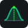

<!-- ======================================================== -->
<!-- 3D FACE POINT CLOUD // COMPUTATIONAL IDENTITY            -->
<!-- ======================================================== -->

  

<!-- ======================================================== -->
<!-- 2. GITHUB CONTRIBUTION SNAKE (IMMEDIATELY AFTER HERO)   -->
<!-- ======================================================== -->
<picture>
  <source media="(prefers-color-scheme: dark)" srcset="https://raw.githubusercontent.com/viraksak/viraksak/output/github-contribution-grid-snake-dark.svg">
  <source media="(prefers-color-scheme: light)" srcset="https://raw.githubusercontent.com/viraksak/viraksak/output/github-contribution-grid-snake.svg">
  
</picture>

 
<!-- ======================================================== -->
<!-- 3. IDENTITY BADGES                                       -->
<!-- ======================================================== -->

  
  
  
   
  

---

<!-- ======================================================== -->
<!-- 4. DIGITAL DNA                                           -->
<!-- ======================================================== -->
### DNA

  

#### 🔹 PROGRAMMING LANGUAGES

#### 🔹 DATA SCIENCE & ANALYTICS

 

 

#### 🔹 AI / MACHINE LEARNING & COMPUTER VISION

 

#### 🔹 WEB, BACKEND & DATABASES

#### 🔹 TOOLS & DEVOPS

---

<!-- ======================================================== -->
<!-- ======================================================== -->
<!-- 5. CLASSIFIED AI RESEARCH LAB                            -->
<!-- ======================================================== -->
### 🔬 CLASSIFIED AI RESEARCH LAB

  

---

<!-- ======================================================== -->
<!-- 9. TERMINAL / CONTACT                                    -->
<!-- ======================================================== -->

&nbsp;

&nbsp;

&nbsp;

 

CLASSIFIED AI RESEARCH LAB // COPYRIGHT © 2026 VIRAKSAK KOY. ALL RIGHTS RESERVED.

