<!-- ======================================================== -->
<!-- 3D FACE POINT CLOUD // COMPUTATIONAL IDENTITY            -->
<!-- ======================================================== -->

  

<!-- ======================================================== -->
<!-- 2. GITHUB CONTRIBUTION SNAKE (IMMEDIATELY AFTER HERO)   -->
<!-- ======================================================== -->
<picture>
  <source media="(prefers-color-scheme: dark)" srcset="https://raw.githubusercontent.com/viraksak/viraksak/output/github-contribution-grid-snake-dark.svg">
  <source media="(prefers-color-scheme: light)" srcset="https://raw.githubusercontent.com/viraksak/viraksak/output/github-contribution-grid-snake.svg">
  
</picture>

 
<!-- ======================================================== -->
<!-- 3. IDENTITY BADGES                                       -->
<!-- ======================================================== -->

  
  
  
   
  

---

<!-- ======================================================== -->
<!-- 4. DIGITAL DNA                                           -->
<!-- ======================================================== -->
### DNA

  

#### 🔹 PROGRAMMING LANGUAGES

<table>
  <tr>
    <td align="center" width="96"> <b>Python</b></td>
    <td align="center" width="96"> <b>&nbsp;&nbsp;&nbsp;C&nbsp;&nbsp;&nbsp;</b></td>
    <td align="center" width="96"> <b>&nbsp;&nbsp;C++&nbsp;&nbsp;</b></td>
    <td align="center" width="96"> <b>&nbsp;&nbsp;Java&nbsp;&nbsp;</b></td>
  </tr>
  <tr>
    <td align="center" width="96"> <b>&nbsp;&nbsp;&nbsp;R&nbsp;&nbsp;&nbsp;</b></td>
    <td align="center" width="96"> <b>JavaScript</b></td>
    <td align="center" width="96"> <b>TypeScript</b></td>
    <td align="center" width="96"> <b>&nbsp;&nbsp;SQL&nbsp;&nbsp;</b></td>
  </tr>
</table>

#### 🔹 DATA SCIENCE & ANALYTICS

<table>
  <tr>
    <td align="center" width="96"> <b>Data Science</b></td>
    <td align="center" width="96"> <b>EDA</b></td>
    <td align="center" width="96"> <b>Statistics</b></td>
    <td align="center" width="96"> <b>Data Viz</b></td>
  </tr>
  <tr>
    <td align="center" width="96"> <b>Analytics</b></td>
    <td align="center" width="96"> <b>Kaggle</b></td>
    <td align="center" width="96"> <b>Pandas</b></td>
    <td align="center" width="96"> <b>NumPy</b></td>
  </tr>
  <tr>
    <td align="center" width="96"> <b>Matplotlib</b></td>
    <td align="center" width="96"> <b>Seaborn</b></td>
    <td align="center" width="96"> <b>Plotly</b></td>
    <td align="center" width="96"> <b>SciPy</b></td>
  </tr>
  <tr>
    <td align="center" width="96"> <b>Jupyter</b></td>
    <td align="center" width="96"> <b>Excel</b></td>
    <td align="center" width="96"> <b>Tableau</b></td>
    <td align="center" width="96"> <b>Power BI</b></td>
  </tr>
  <tr>
    <td align="center" width="96"> <b>BigQuery</b></td>
    <td align="center" width="96"> <b>Sheets</b></td>
    <td align="center" width="96"></td>
    <td align="center" width="96"></td>
  </tr>
</table>

#### 🔹 AI / MACHINE LEARNING & COMPUTER VISION

<table>
  <tr>
    <td align="center" width="110"> <b>Machine Learning</b></td>
    <td align="center" width="110"> <b>Computer Vision</b></td>
    <td align="center" width="110"> <b>PyTorch</b></td>
  </tr>
  <tr>
    <td align="center" width="110"> <b>TensorFlow</b></td>
    <td align="center" width="110"> <b>Keras</b></td>
    <td align="center" width="110"> <b>Scikit-Learn</b></td>
  </tr>
  <tr>
    <td align="center" width="110"> <b>OpenCV</b></td>
    <td align="center" width="110"> <b>YOLO</b></td>
    <td align="center" width="110"> <b>Hugging Face</b></td>
  </tr>
</table>

#### 🔹 WEB, BACKEND & DATABASES

<table>
  <tr>
    <td align="center" width="100"> <b>Next.js</b></td>
    <td align="center" width="100"> <b>FastAPI</b></td>
    <td align="center" width="100"> <b>PostgreSQL</b></td>
  </tr>
  <tr>
    <td align="center" width="100"> <b>Firebase</b></td>
    <td align="center" width="100"> <b>SQL Server</b></td>
    <td align="center" width="100"></td>
  </tr>
</table>

#### 🔹 TOOLS & DEVOPS

<table>
  <tr>
    <td align="center" width="100"> <b>Git</b></td>
    <td align="center" width="100"> <b>GitHub</b></td>
    <td align="center" width="100"> <b>Docker</b></td>
  </tr>
</table>

---

<!-- ======================================================== -->
<!-- ======================================================== -->
<!-- 5. CLASSIFIED AI RESEARCH LAB                            -->
<!-- ======================================================== -->
### 🔬 CLASSIFIED AI RESEARCH LAB

  

---

<!-- ======================================================== -->
<!-- 9. TERMINAL / CONTACT                                    -->
<!-- ======================================================== -->

&nbsp;

&nbsp;

&nbsp;

